# Webinar Deck Content: From Zero to Deployed AI Agents

**Audience:** students who are new to AI. They do not know how companies build software.
**Level:** easy ideas, always with a real-life example. A small amount of code (short pieces from our real project). Many pictures and flow diagrams.
**Length:** 47 slides, 120 minutes.
**Status:** this is the content plan for review. No PowerPoint has been built yet.

## How to read this file
Each slide has these parts:
- **On slide:** the words the audience reads.
- **Example:** a real-life story.
- **Diagram:** a Mermaid diagram. Paste it into any Mermaid viewer to get a picture.
- **Code:** a short piece from our project.
- **Say:** what the speaker says.
- **Image:** which picture to use.

Tags:
- **[BUILT]** we built it and tested it.
- **[NEXT]** we plan to build it. It does not exist yet.
- **[CONCEPT]** we only explain the idea.
- **[VERIFY]** this changes fast (names, prices, limits). Check it again one week before the session.

## Assumptions (tell me to change any)
- We do not name our company product. "How companies use AI" stays general.
- The live demo is done only by the presenter. The audience does not use our site, because the free Gemini key allows only about 15 requests per minute. Keep a screen recording as backup.
- Students get the project link and a word list (glossary) to take home.
- Q&A is at the end. Questions in chat are answered at the breaks.

## Time plan
| Section | Slides | Minutes |
|---|---|---|
| A. Welcome and the problem | 1-2 | 4 |
| B. AI, ML, deep learning, generative AI | 3-6 | 12 |
| C. LLMs, big models, open models, company use | 7-11 | 14 |
| D. Agent = LLM + harness, LangChain, LangGraph | 12-18 | 16 |
| E. Personas, skills, connectors, plugins | 19-22 | 8 |
| F. RAG: extract, chunk, embed, store, retrieve | 23-28 | 16 |
| G. Advanced RAG | 29-31 | 7 |
| H. MCP and sharing it with other agents | 32-35 | 10 |
| I. Our architecture and the live demo | 36-38 | 11 |
| J. Deploying on Render | 39-41 | 6 |
| K. Model providers and self-hosting | 42-45 | 10 |
| L. Wrap-up and Q&A | 46-47 | 6 |

---

# A. Welcome and the problem

## Slide 1: Title
**On slide:** From zero to deployed AI agents. How modern AI works, and how we built one that answers from documents and a database.
**Say:** By the end, you will understand the words you hear all the time: LLM, RAG, agent, MCP. You will also see one working example from start to end.
**Image:** a simple title slide with a robot and a document.

## Slide 2: One question no tool can answer today
**On slide:** "Which late deliveries get a refund, and how much do we owe?"
- The rule is in a PDF.
- The facts are in a database.
- No single tool uses both.
**Example:** A support worker opens the PDF in one window, asks a colleague to run a database query, and then joins the two answers by hand.
**Diagram:**
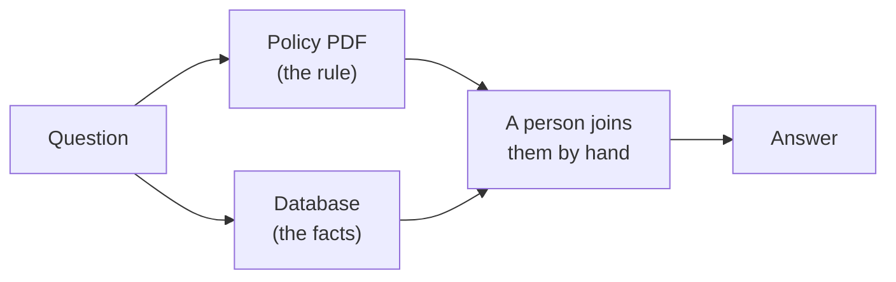
**Say:** Today we learn how to automate the middle box. Then show the agenda.
**Image:** a person between a pile of papers and a spreadsheet.

---

# B. AI, ML, deep learning and generative AI

## Slide 3: The AI map
**On slide:** AI is the big idea. Machine learning is a part of AI. Deep learning is a part of machine learning. Generative AI is a part of deep learning.
**Example:** AI: a chess program. Machine learning: a spam filter that learns from examples. Deep learning: unlocking your phone with your face. Generative AI: writing an email for you.
**Diagram:**
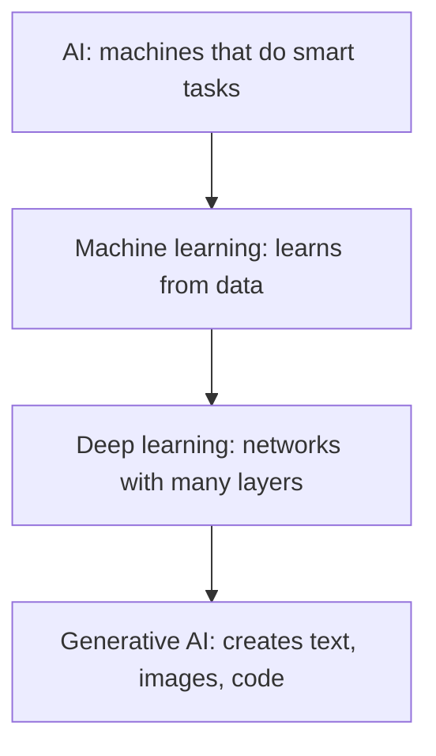
**Say:** Think of circles inside circles. Today we live in the smallest circle, plus the tools around it.
**Image:** four circles, one inside the other.

## Slide 4: How machines learn
**On slide:** There are three ways: supervised, unsupervised and reinforcement learning.
**Example:**
- Supervised: show 10,000 emails marked "spam" or "not spam".
- Unsupervised: group shoppers by what they buy, with no labels.
- Reinforcement: a game program gets points when it wins.
**Diagram:**
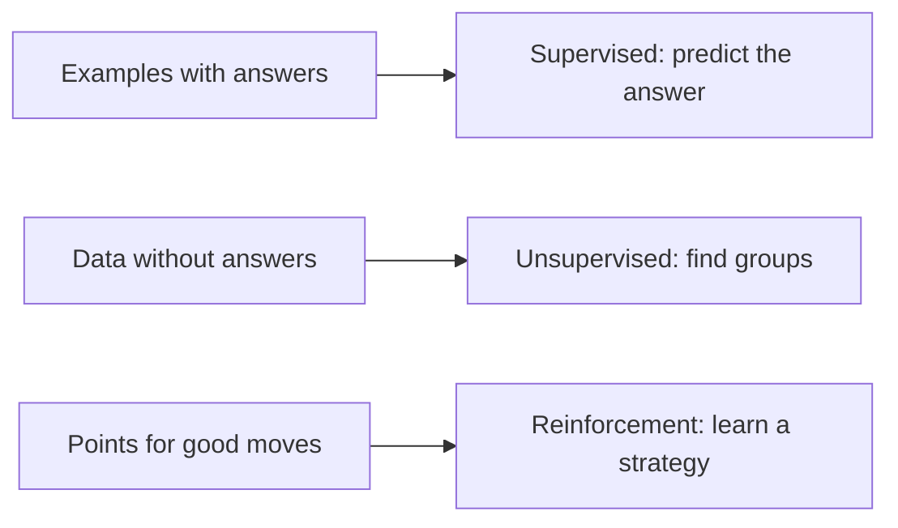
**Say:** Most business machine learning is supervised, like fraud or churn prediction.
**Image:** three small pictures: labelled envelopes, colored groups, a game controller.

## Slide 5: Neural networks and deep learning
**On slide:** A neural network is layers of numbers called weights. Training means changing the weights until the answers get better.
**Example:** Teaching a child what a cat is. Show many cats. Each time the child is wrong, correct them. Slowly the child gets it right.
**Diagram:**
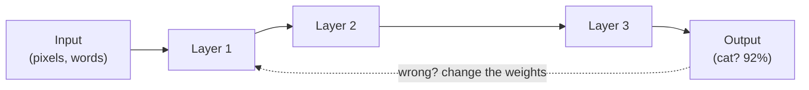
**Say:** "Deep" just means many layers. The dotted line is training.
**Image:** a picture of a neural network.

## Slide 6: Transformers, the big idea from 2017
**On slide:** A transformer reads all the words at once and decides which words are linked to each other. This is called attention.
**Example:** "The bank raised interest rates" and "we sat on the river bank". Attention helps the model know which bank is meant.
**Diagram:**
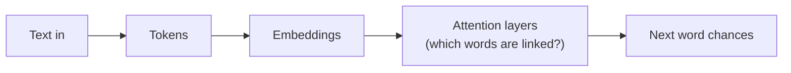
**Say:** The paper was named "Attention Is All You Need" (2017). Every big model today is a larger transformer.
**Image:** a sentence with arcs between linked words.

---

# C. LLMs, big models and open models

## Slide 7: What an LLM really is
**On slide:** A large language model (LLM) guesses the next token, again and again.
- Token: a small piece of a word.
- Context window: how much text the model can read at once.
- Temperature: how random the answer is.
- Training: how the model learns. Inference: when we use it.
**Example:** The word suggestions on your phone keyboard, but trained on a huge part of the internet.
**Diagram:**
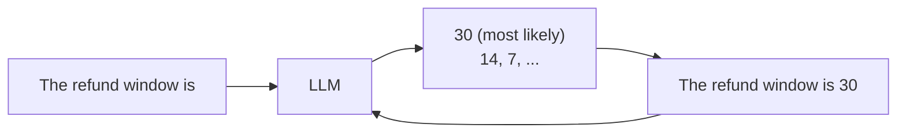
**Say:** It does not look things up. It writes text that sounds right. That is why it can sound sure and still be wrong.
**Image:** a keyboard suggestion bar that grows into a paragraph.

## Slide 8: Frontier models
**On slide:** Frontier models are the strongest models from the top labs. You usually use them through an API.
- Good at reasoning, writing code, and reading images and long documents.
- You pay per use. You do not get the model files. [VERIFY current model names]
**Example:** A developer asks the model to review code. A lawyer asks it to summarize a 200-page contract.
**Say:** "Frontier" means the best today. It changes every few months. Learn the ideas, not the names.
**Image:** a podium with unnamed logos.

## Slide 9: Open models, and three ways to use any model
**On slide:** Open-weight models share their files, so you can run them yourself.
- Families: Llama, Qwen, Gemma, DeepSeek, Mistral. [VERIFY]
- Three ways to use a model: a chat app, an API, or your own machine.
**Example:** A hospital cannot send patient notes to an outside company. So it runs an open model on its own servers.
**Diagram:**
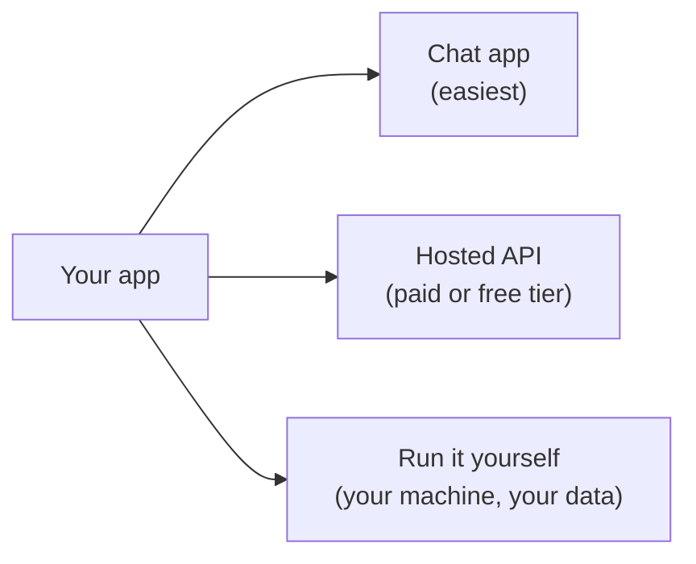
**Say:** "Open-weight" is not always "open-source". Read the license. In our own Gemini account's model list we even saw Gemma models, which are open-weight.
**Image:** three doors: easy, flexible, private.

## Slide 10: How companies use LLMs
**On slide:** Most companies use the same recipe: a model + company data + the power to act.
- Support assistants, coding helpers, document search, data analysis, report writing.
**Example:** A bank assistant reads the policy documents, checks the customer's account data, and writes a draft reply. A person approves it.
**Diagram:**
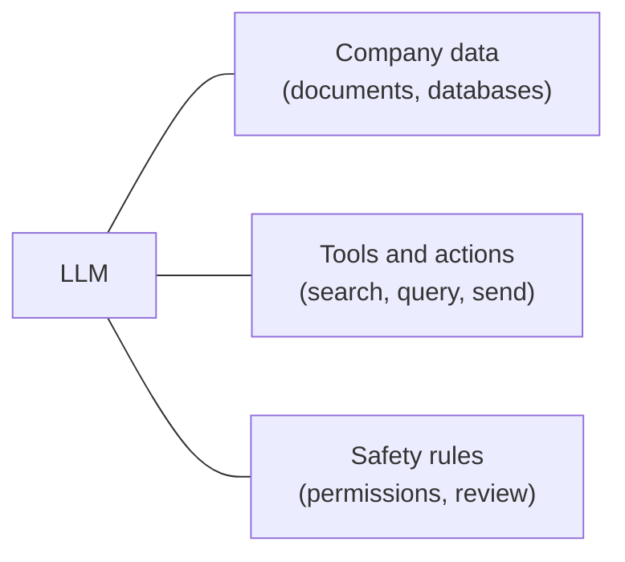
**Say:** The model is only one part. The rest of today is about the other parts.
**Image:** a building connected by three pipes.

## Slide 11: What a plain LLM cannot do
**On slide:** It can make things up. It has a knowledge cut-off date. It can read only a limited amount of text. It costs money. It can leak private data if you are careless.
**Example from our project:** the model name we first chose was shut down for new users, and our free key allowed only 15 requests per minute. Real systems must handle changing models and limits.
**Diagram:**
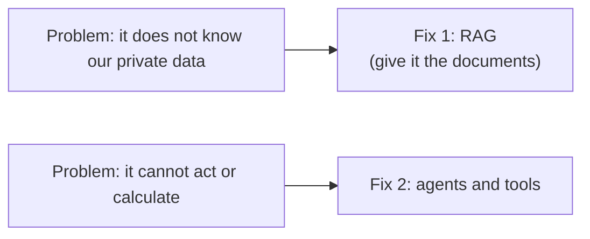
**Say:** The next two sections explain these two fixes.
**Image:** a brain with a fence labelled "knowledge cut-off".

---

# D. Agent = LLM + harness

## Slide 12: A plain LLM is not an agent
**On slide:** An LLM answers once. An agent works step by step toward a goal.
**Example:** Asking a friend one question is like using an LLM. Hiring an assistant who looks things up, does the math, and comes back with an answer is like an agent.
**Say:** The difference is everything we build around the model.
**Image:** a talking head next to a person with a toolbox.

## Slide 13: Agent = LLM + harness [BUILT]
**On slide:** The harness is everything around the model: the loop, the tools, the memory, the context control, and the safety rules.
**Example:** A new employee (the LLM) cannot do much without a handbook, tools, a desk and a manager's rules (the harness).
**Diagram:**
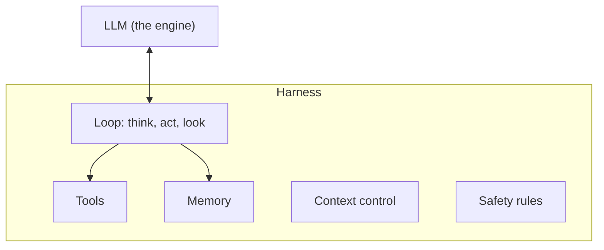
**Say:** Think of an engine inside a car. In our project, the harness is a loop that can call 6 tools and stops after 8 steps.
**Image:** an engine inside a car.

## Slide 14: LangChain, the building blocks [BUILT]
**On slide:** LangChain is a toolbox with ready-made parts: model connectors, tool definitions, prompts and retrievers.
**Example:** Lego bricks. You build faster because you do not make every brick yourself.
**Code:**
```python
@tool
def run_sql(sql: str):
    """Run ONE read-only SQLite SELECT."""
    return retrieval.run_sql(sql)
```
**Say:** The text in quotes is not just a comment. The model reads it to decide when to use the tool.
**Image:** colored bricks named model, tool, prompt, retriever.

## Slide 15: LangGraph, the agent as a map [BUILT]
**On slide:** In LangGraph you draw the agent as a map: steps (nodes), arrows (edges) and shared state. The state can be saved between turns.
**Example:** A subway map. The agent travels from station to station (think, use a tool) until it reaches the last stop.
**Diagram (our real graph):**
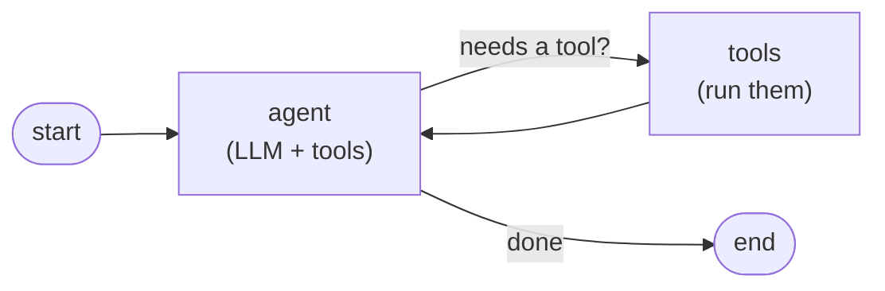
**Code:**
```python
g = StateGraph(MessagesState)
g.add_node("agent", agent_node)
g.add_node("tools", ToolNode(tools))
g.add_conditional_edges("agent", tools_condition)
g.add_edge("tools", "agent")
```
**Say:** Five lines define the whole loop. The tool can even draw this picture for us.
**Image:** the graph above as boxes and arrows.

## Slide 16: LangChain agent vs LangGraph agent [BUILT] [VERIFY names]
**On slide:**
| | LangChain agent | LangGraph agent |
|---|---|---|
| What it is | A ready-made agent. You give it a model and tools. | An agent you draw yourself with steps and arrows. |
| Setup | A few lines | More code, more control |
| Flow | One simple loop: think, use a tool, think again | Any flow you design: branches, loops, parallel steps |
| Memory | Basic | Saved at every step (checkpoints) |
| Human approval | Possible with extra hooks | Easy: pause at any step and wait for a person |
| Many agents together | Hard | Natural: each agent is one step |
| Best for | A quick start, simple assistants | Complex, long, or business-critical flows |
| In our project | We used its tool and model parts | We drew the loop with it |

**Example:** LangChain agent is like taking a taxi: say where you want to go. LangGraph agent is like planning the route yourself: you choose every stop and every turn.
**Diagram:**
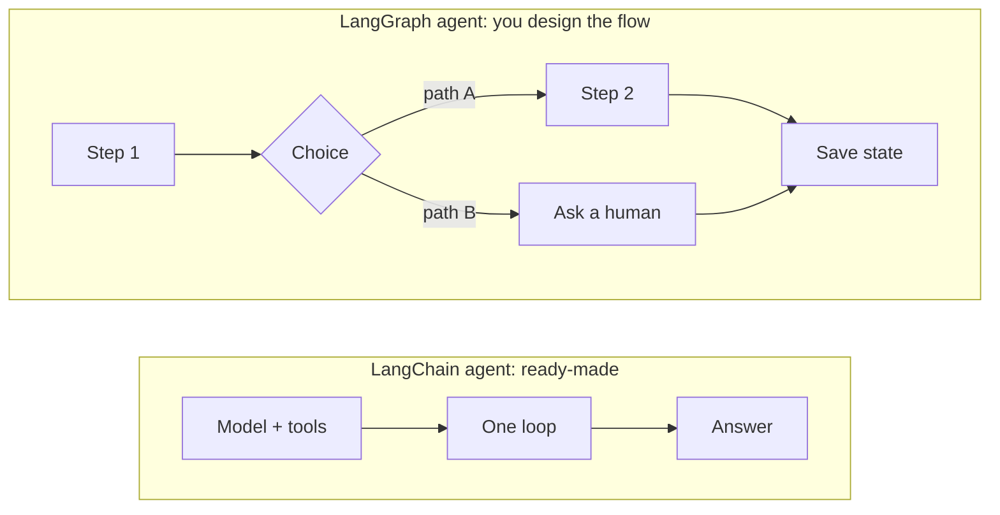
**Say:** They are not enemies. Today a LangChain agent actually runs on LangGraph inside. LangChain is the quick path, and LangGraph is the control panel. Many real products use both.
**Image:** a taxi next to a map with a planned route.

## Slide 17: Our agent built two ways [BUILT]
**On slide:** We built the same agent as a hand-written loop and again with LangGraph.
- Both used the same tools in the same order on all three test questions. The answers matched.
- LangGraph added saved memory: the follow-up "And for Gold?" worked without sending the old chat again.
- The cost was about 31 MB more memory.
**Example:** The same trip with paper directions or with GPS. The GPS adds re-routing and saved trips.
**Diagram:**
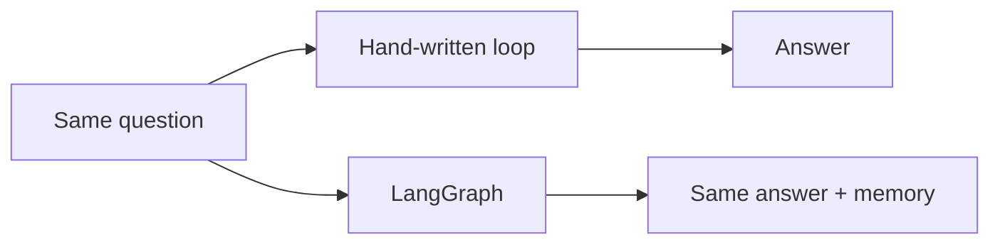
**Image:** two screenshots of the tool steps side by side.

## Slide 18: When to use which
**On slide:** Start with the simplest thing that works. Use a framework when you need:
- memory across sessions, a human to approve steps, long-running work, or many agents.
**Example:** A bicycle is fine for the shop down the road. You need a truck only when moving house.
**Say:** Real products add a database for chat memory, short summaries of long chats, and automatic retries. LangGraph gives places to plug these in.
**Image:** a bicycle and a truck.

---

# E. Personas, skills, connectors, plugins

## Slide 19: Personas [BUILT]
**On slide:** A persona is a role. It has instructions, allowed tools and allowed skills.
**Example:** One employee wearing different hats: support worker, data analyst, policy advisor.
**Diagram:**
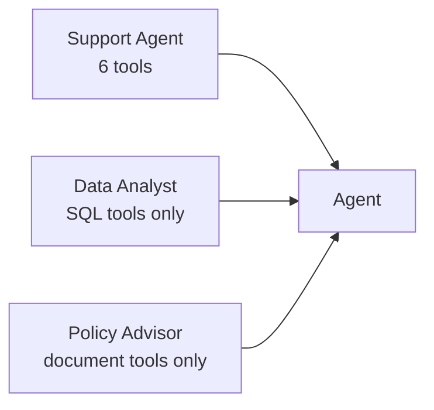
**Code (a persona is just a text file):**
```
---
name: Policy Advisor
tools: search_docs, list_documents, get_document_page
skills: docs-research
---
You explain policies exactly. You cannot see orders.
```
**Say:** The server enforces the limits, not only the prompt. A tool outside the persona's list is never shown to the model, and it is refused if the model tries to call it.
**Image:** one person with three hats.

## Slide 20: Persona test results [BUILT]
**On slide:**
- Policy Advisor asked for customer revenue: said no, and never touched SQL.
- Data Analyst asked for the refund window: said no, and never touched the documents.
- Support Agent with a Gold customer 4 days late: used the 10% credit and wrote a reply for the customer.
**Say:** This is called least privilege: give each role only what it needs.
**Image:** screenshots of the three answers.

## Slide 21: Skills and connectors [BUILT]
**On slide:**
- A skill is a written playbook, like a recipe card.
- A connector is a link to data or an app, so the agent can reach it.
**Example:** A recipe is useless without a kitchen. A kitchen without a recipe makes a mess.
**Code (a skill file):**
```
---
name: docs-plus-data
description: Use when a question needs a policy rule AND facts from the database.
---
1. Rule first (search_docs). 2. Facts second (run_sql). 3. Combine them.
```
**Image:** a recipe card next to a kitchen.

## Slide 22: Plugins, the package [BUILT]
**On slide:** A plugin puts skills, shortcuts (slash commands) and connector settings into one package. A user installs it in one step.
- Ours has 3 skills and 4 commands: /brightline:ask, :policy, :late-orders, :customer.
- Two versions: a safe one to share, and a personal one that has a secret inside.
**Example:** A welcome kit for a new employee: handbook, login details and shortcuts.
**Diagram:**
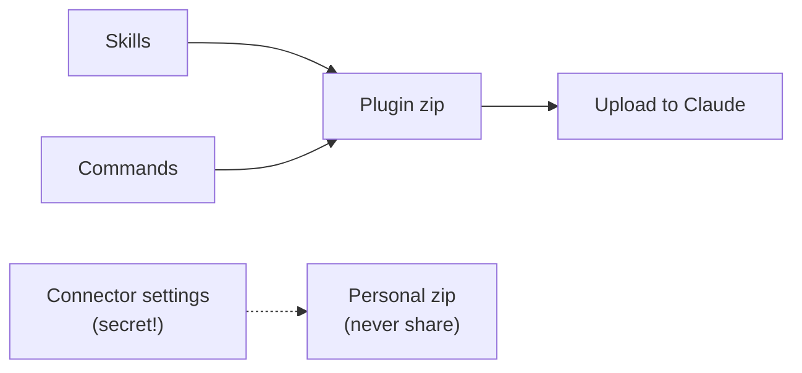
**Say:** Never put a password or token in a file you plan to share.
**Image:** a gift box, and a second box with a lock.

---

# F. RAG: from documents to answers

## Slide 23: Why RAG, the open-book exam [BUILT]
**On slide:** RAG means "retrieve, then generate". First find the right pages. Then let the model answer using them.
**Example:** An open-book exam. You do not memorize the whole book. You find the right page and write your answer from it.
**Diagram:**
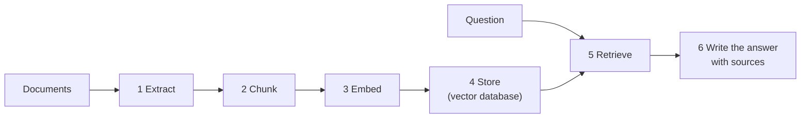
**Say:** Steps 1 to 4 happen once for each document. Steps 5 and 6 happen for every question.
**Image:** a student with an open textbook.

## Slide 24: Step 1, extraction [BUILT]
**On slide:** Turn files (PDF, Word, web pages) into clean text, one page at a time.
- Hard parts: tables, scanned pages (need OCR) and pages with many columns.
**Example:** When you copy a table from a PDF, it often becomes a mess. Extraction tools try to keep it tidy.
**Code:**
```python
reader = PdfReader("02_shipping_and_delivery_sla.pdf")
text = reader.pages[0].extract_text()
```
**Image:** a PDF page turning into plain text.

## Slide 25: Step 2, chunking [BUILT]
**On slide:** Cut the text into small passages. Our rule: about 900 characters each, with 150 characters of overlap. Our 5 PDFs became 21 chunks.
**Example:** Index cards. If a card is too big, you cannot find the fact. If it is too small, it makes no sense alone.
**Diagram:**
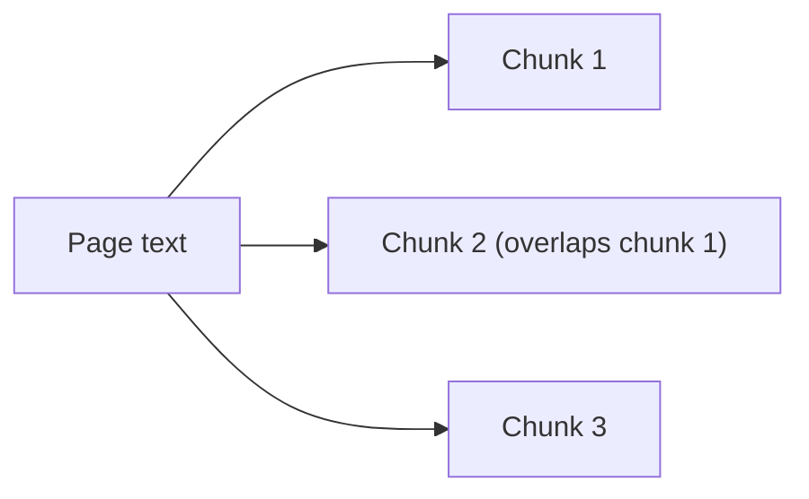
**Code:**
```python
CHUNK_CHARS = 900
CHUNK_OVERLAP = 150   # so a sentence is not cut in half
```
**Image:** a page cut into colored index cards.

## Slide 26: Step 3, embeddings [BUILT]
**On slide:** An embedding turns text into a list of numbers (ours has 768). Texts with similar meaning get similar numbers.
**Example:** A map. Restaurants close to each other have similar coordinates. Embeddings are coordinates for meaning, so "refund" and "money back" are close together.
**Diagram:**
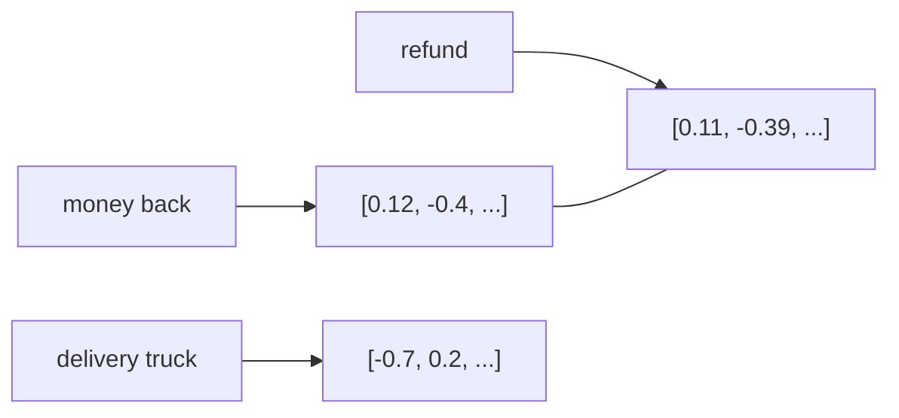
**Code:**
```python
res = client.models.embed_content(model="gemini-embedding-001", contents=chunks,
        config=EmbedContentConfig(task_type="RETRIEVAL_DOCUMENT", output_dimensionality=768))
```
**Say:** Use the same embedding model for the documents and for the questions.
**Image:** a map with one group named "returns" and another named "shipping".

## Slide 27: Step 4, storing in a vector database [BUILT]
**On slide:** A vector database finds the closest vectors fast. We use Qdrant. It saves plain files, and each vector keeps its text, file name and page.
- On free hosting the disk is wiped, so our app rebuilds the index when it starts (21 chunks, a few seconds).
**Example:** A library where books are placed by topic, not by alphabet.
**Diagram:**
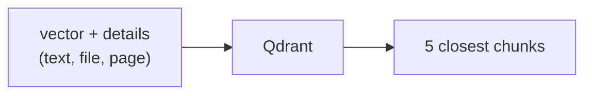
**Image:** a library with shelves by topic.

## Slide 28: Steps 5 and 6, retrieve, then write the answer [BUILT]
**On slide:** The question becomes a vector. We fetch the closest chunks. The model writes an answer using only those chunks, and shows its sources.
**Example:** An HR bot gets "How many leave days do I get?". It finds the leave-policy page and quotes it.
**Code (what the model sees, simplified):**
```
Question: What is the refund window for damaged items?
Passage [Returns Policy, p.1]: "Damage in transit must be reported within 7 days..."
```
**Say:** Sources let a person check the answer. Show a real search result and its score.
**Image:** a screenshot of search results with sources.

---

# G. Advanced RAG

## Slide 29: Hybrid search and reranking
**On slide:** Mix search by meaning (vectors) with search by exact words (BM25), then merge the two lists. [BUILT]
- A reranker re-checks the top results with a stronger model. [CONCEPT]
**Example:** Search for "Platinum". Vector search may mix it up with other tiers. Exact-word search finds it right away.
**Diagram:**
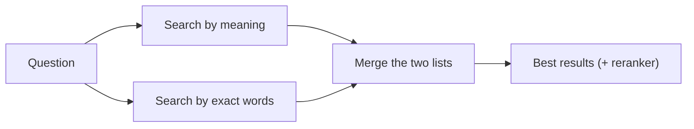
**Code:**
```python
score += 1.0 / (60 + rank + 1)   # merge rankings (reciprocal-rank fusion)
```
**Image:** two ranked lists joining into one.

## Slide 30: Agentic RAG, with documents and a database [BUILT]
**On slide:** The agent chooses what to look up, from which source, in how many steps.
- Documents for rules. SQL for numbers. Both when we must apply a rule to the data.
- Rewriting the question and multi-step lookups are more ideas. [CONCEPT]
**Example from our project:** the late-delivery question. The agent searched the policy for the credit bands, looked at the shipments table, then ran one SQL query. 50 of 287 delivered shipments were late: 20, 17 and 13 in the three bands. Every number matched our own check.
**Diagram:**
```mermaid
flowchart LR
  Q["Late orders: what do we owe?"] --> D["search_docs: credit bands 5% / 10% / 15%"]
  D --> S["list_tables, describe_table"]
  S --> SQL["run_sql: count late orders per band"]
  SQL --> A["Answer with sources and a table"]
```
**Image:** the tool-steps panel from our app.

## Slide 31: Testing, safety rules and cost
**On slide:**
- Test with real questions and check the answers yourself. [BUILT: we checked numbers with direct SQL]
- Safety rules: read-only SQL, one statement, limits on rows and time, limits on requests. [BUILT]
- Cost and speed: prompt caching reuses the part of the prompt that never changes. [BUILT, measured]
**Example (measured):** Our prompt is about 1,400 tokens and got no automatic cache hits. A test prompt of about 9,500 tokens reused 6,121 tokens from the cache. Caching helps only when the repeated part is big. The explicit cache feature was not available on our free key.
**Say:** Measure, do not guess. Our agent now shows prompt tokens and cached tokens for every answer.
**Image:** two bars: tokens with and without cache.

---

# H. MCP

## Slide 32: What is MCP
**On slide:** Model Context Protocol (MCP) is an open standard. It lets any AI app connect to tools and data in the same way.
**Example:** USB-C. One plug works with many devices. Before it, every device had its own cable.
**Diagram:**
```mermaid
flowchart LR
  A1["Claude"] --> M["MCP"]
  A2["Other agents"] --> M
  A3["Code editors"] --> M
  M --> S1["Documents server"]
  M --> S2["Database server"]
  M --> S3["Calendar server"]
```
**Say:** Without MCP, 5 apps and 5 tools need 25 custom links. With MCP, you need 5 + 5.
**Image:** many cables becoming one USB-C plug.

## Slide 33: Our MCP server [BUILT]
**On slide:** Six tools: search_docs, list_documents, get_document_page, list_tables, describe_table, run_sql.
- It only returns data. The caller's own model writes the answer.
- The tool descriptions are the rules the caller reads.
**Code:**
```python
@mcp.tool()
def search_docs(query: str, k: int = 5) -> dict:
    """Search the company policy PDFs ... Returns passages with a 'citation'."""
    return {"results": retrieval.search_docs(query, k)}
```
**Diagram (two doors, one room):**
```mermaid
flowchart LR
  R["Shared retrieval code"] --> M["/mcp: data only"]
  R --> A["/agent: data + Gemini answer"]
```
**Image:** two doors into the same room.

## Slide 34: Sharing it with other agents [BUILT]
**On slide:** One link and one secret let any MCP-ready agent use your data.
- Claude on the web or desktop: add a custom connector with the link.
- Claude Code: `claude mcp add --transport http brightline <url> --header "Authorization: Bearer <token>"`
- Other tools: add the same link in their MCP settings.
**Example:** Giving a teammate's AI assistant read access to your team's knowledge with one link.
**Diagram:**
```mermaid
flowchart LR
  C1["Claude (web)"] --> U["https://.../mcp"]
  C2["Claude Code"] --> U
  C3["Another MCP agent"] --> U
  U --> S["Our server on Render"]
```
**Say:** We tested with a real MCP client and with the live link.
**Image:** one link icon with arrows from three apps.

## Slide 35: Keeping an MCP server safe
**On slide:**
- A secret token is required. [BUILT] The database is read-only. [BUILT] Requests are limited. [BUILT]
- Real products use OAuth sign-in with a permission for each user. [CONCEPT]
- A lesson we learned: a hosted server rejects unknown website names until you set it up.
**Example:** A token inside a link is like a key under the doormat. It is fine for a demo, not for a bank.
**Say:** Never paste keys or tokens into chats or slides. If one leaks, change it.
**Image:** a key and a padlock.

---

# I. Our architecture and the live demo

## Slide 36: Our project architecture, with the intent classifier [BUILT + NEXT]
**On slide:** One question goes in. The system decides which kind of data it needs, then uses only the right tools.
- **Intent classifier [NEXT]:** a small first step that reads the question and picks a route.
  - Unstructured route: documents (PDF search).
  - Structured route: database (SQL tools).
  - Both route: documents first, then SQL.
  - Other: chit-chat or out of scope, answer politely without tools.
- **Agent [BUILT]:** LangGraph loop with a persona, skills and the allowed tools.
- **Shared retrieval [BUILT]:** hybrid search over Qdrant plus BM25, and read-only SQL on SQLite.
- **Two doors [BUILT]:** /agent for answers, /mcp for other agents.

**Today vs next:**
- Today the model picks the route by itself, by reading tool descriptions and skills. Personas can limit the tools by hand.
- With a classifier, routing is an explicit, testable step. The model sees fewer tools, so it makes fewer mistakes, and answers can be faster and cheaper.
- Trade-offs: one extra model call (and our free key allows only 15 requests per minute), and a wrong route can hide the right tool. A safe fallback is "if unsure, route to both".

**Example:** A hospital front desk. The receptionist (classifier) asks "billing, medical records, or both?" and sends you to the right desk. The desk staff (agent) then does the work.
**Diagram:**
```mermaid
flowchart TB
  U["User: web app / Claude / other agents"] --> D1["/agent"]
  U --> D2["/mcp (data only)"]

  subgraph AGENT["Agent door"]
    D1 --> IC{"Intent classifier [NEXT]"}
    IC -- "unstructured" --> TD["Document tools<br/>search_docs, get_document_page"]
    IC -- "structured" --> TS["SQL tools<br/>list_tables, describe_table, run_sql"]
    IC -- "both" --> TB["Documents first, then SQL"]
    IC -- "other" --> NA["Polite answer, no tools"]
    TD --> LG["LangGraph agent<br/>persona + skills + prompt cache"]
    TS --> LG
    TB --> LG
    LG --> GEM["Gemini writes the answer"]
  end

  D2 --> R
  TD --> R["Shared retrieval layer"]
  TS --> R
  R --> Q["Qdrant (meaning search) + BM25 (word search)"]
  R --> DB["SQLite database (read-only)"]
  Q --> PDF["5 policy PDFs"]
```
**Code (a sketch of the idea, not built yet):**
```python
intent = classify(question)            # "documents" | "database" | "both" | "other"
tools = TOOLS_BY_INTENT[intent]        # the agent only sees the tools for that route
answer = agent.run(question, tools=tools)
```
**Say:** This slide is the map of the whole talk. Point to each box and say which slide explained it. Be honest: the classifier is the next feature. Explain how it could work: a small, fast model call, or simple rules, plus a fallback to "both".
**Image:** the diagram above, with the classifier box highlighted and labelled "next".

## Slide 37: Demo script [BUILT]
**On slide:**
1. Documents only: "What is the refund window for damaged items?"
2. Database only: "Top 3 customers by revenue, excluding cancelled orders."
3. Both: "Which delivered orders were late, and what credit does the policy give per band?"
4. Switch persona: ask the same question as Policy Advisor, then as Support Agent.
5. In Claude: use the same data through the connector.
**Say:** Open the tool-steps panel so the audience sees the agent working. Wake the server 5 minutes before. Only the presenter uses it. Keep the recording ready.
**Image:** one screenshot for each step.

## Slide 38: What we checked [BUILT]
**On slide:**
- Refund: report damage in 7 days, and the company pays return shipping.
- Top customers: Zenith Associates, Xenon Group, Fairway Solutions.
- Late deliveries: 50 of 287. The three bands had 20 (5%), 17 (10%) and 13 (15%).
- Both agent versions agree. Attempts to change the database were blocked.
**Say:** Trust, but check. We recalculated every number with direct SQL.
**Image:** green ticks next to each result.

---

# J. Deploying on Render

## Slide 39: From laptop to a public link [BUILT]
**On slide:** Put the code on GitHub. Connect GitHub to Render. Set a build command and a start command. Add secrets as environment variables.
**Diagram:**
```mermaid
flowchart LR
  L["Your laptop"] -- "git push" --> G["GitHub"] -- "auto deploy" --> R["Render builds and runs it"] --> U["https://your-app.onrender.com"]
```
**Code (the two commands):**
```
Build: pip install -r requirements.txt
Start: uvicorn app.main:app --host 0.0.0.0 --port $PORT
```
**Image:** screenshots of the Render settings page (hide the secrets).

## Slide 40: Secrets and access [BUILT]
**On slide:** Keep keys in environment variables, never in code. We protect `/mcp` with a token and the website with a password.
**Example:** Lock the front door, and give each visitor the right key.
**Say:** The free plan sleeps after 15 idle minutes, and its disk is wiped. Our app rebuilds its search index at startup to handle this.
**Image:** a settings page with hidden values.

## Slide 41: Updating and fixing problems [BUILT]
**On slide:** Every push to the main branch deploys again by itself. If the new version fails, the old one keeps running.
- Read the logs. Keep a switch to go back (we can set the agent back to the simple loop).
**Diagram:**
```mermaid
flowchart LR
  P["Push"] --> B["Build"] --> H{"Health check OK?"}
  H -- "yes" --> L["New version is live"]
  H -- "no" --> K["Old version keeps running"]
```
**Image:** a deploy log with green and red lines.

---

# K. Model providers and self-hosting

## Slide 42: API providers [CONCEPT] [VERIFY]
**On slide:** Where to get models if you do not own hardware.
- Gemini API (Google): a free tier that is good for learning.
- Groq: very fast hosted open models.
- OpenRouter: one key for many models.
- Hugging Face: a model hub plus hosted use.
- Together, Mistral and others.
**Code (many providers accept the same style of call):**
```python
from openai import OpenAI
client = OpenAI(base_url="https://<provider-endpoint>/v1", api_key="...")
client.chat.completions.create(model="<model>", messages=[...])
```
**Say:** Many providers copy the OpenAI-style API. Switching is often just a new link and a new key.
**Image:** a grid of provider names.

## Slide 43: Free tiers and their catches [BUILT lessons] [VERIFY details]
**On slide:**
- Strict limits: we hit 15 requests per minute on our Gemini key.
- Models are retired: our first model name stopped working for new users.
- Some features are missing on free tiers: the explicit prompt-cache feature gave an error on our key.
- Treat keys like passwords.
**Say:** Put model names in settings, not in code. Add retries and fallbacks.
**Image:** a gauge close to its limit.

## Slide 44: Running open models yourself [CONCEPT] [VERIFY]
**On slide:** Run a model on your own computer or server.
- Tools: Ollama, LM Studio, llama.cpp (easy, local), vLLM (for servers).
- Models: the Qwen, Llama, Gemma, DeepSeek and Mistral families.
- Rule of thumb: a small model (a few billion parameters), made smaller by compression (quantization), can run on a modern laptop. Bigger models need GPUs.
**Code (local, for illustration):**
```
ollama run <model-name>
# then call http://localhost:11434 from your app
```
**Example:** A student runs a small Qwen model offline on a laptop for a campus project. No data leaves the machine.
**Diagram:**
```mermaid
flowchart LR
  A["Your agent code"] --> O["Local server (Ollama)"] --> W["Model files on your disk"]
```
**Image:** a laptop with a small chip.

## Slide 45: How to choose
**On slide:**
| You need | Good choice |
|---|---|
| To learn fast and cheaply | A free-tier hosted API |
| The best quality | A frontier model API |
| Data that must stay private | An open model you run yourself |
| Speed for many users | Fast hosted inference |
**Say:** Ask four questions: privacy, cost, quality, effort. You can mix them: keep private data local and use the cloud for the hard thinking.
**Image:** a simple decision tree.

---

# L. Wrap-up

## Slide 46: What to build next
**On slide:** Project ideas for students.
- A study assistant over your own notes (RAG).
- A SQL assistant for a campus or sports dataset (agent + read-only SQL).
- An MCP server that shares any dataset with any AI tool.
- Add an intent classifier, a reranker and a test set to our demo.
**Diagram (a learning path):**
```mermaid
flowchart LR
  A["Python + APIs"] --> B["Prompting"] --> C["RAG"] --> D["Agents + tools"] --> E["MCP + deploy"]
```
**Image:** a staircase.

## Slide 47: Summary and questions
**On slide:** LLM + your data (RAG) + tools and a harness (agents), connected with MCP, packaged as personas, skills and plugins, and deployed for others to use.
**Say:** One sentence to remember: an agent is an LLM with a harness, and RAG is how it reads your data. Share the project link and the word list. Open the Q&A.
**Image:** the five building blocks in a row.

---

# Appendix

## Glossary (give it as a handout)
Token, context window, temperature, embedding, vector, vector database, chunk, RAG, hybrid search, BM25, reranker, intent classifier, agent, harness, tool, skill, persona, MCP, connector, plugin, LangChain, LangGraph, checkpoint, prompt cache, rate limit, API key, open-weight, quantization, self-hosting.

## Pictures and screenshots to prepare
- Diagrams: slide 2 problem, slide 3 circles, slide 13 engine in a car, slides 15 and 16 graphs, slide 23 RAG pipeline, slide 26 embedding map, slide 32 MCP hub, slide 34 link fan-out, slide 36 architecture, slide 39 deploy flow. All Mermaid blocks can be exported as images.
- Screenshots from our app: chat with the tool-steps panel, the persona drop-down, Documents search results, Render settings (hide secrets), the Claude connector list.

## Before presenting
- [ ] Check every [VERIFY] item again (model names, provider limits, hardware advice).
- [ ] Wake the Render service 5 minutes early. Only the presenter uses the demo. Have a screen recording ready.
- [ ] Do not show the connector settings page or any link that has a token in it. Change the tokens beforehand.
- [ ] Test screen share, polls and chat.
- [ ] Decide if the intent classifier will be built before the session. If not, keep it labelled [NEXT] on slide 36.
