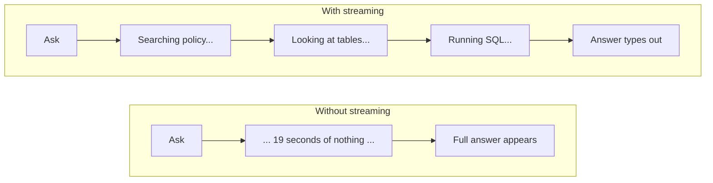
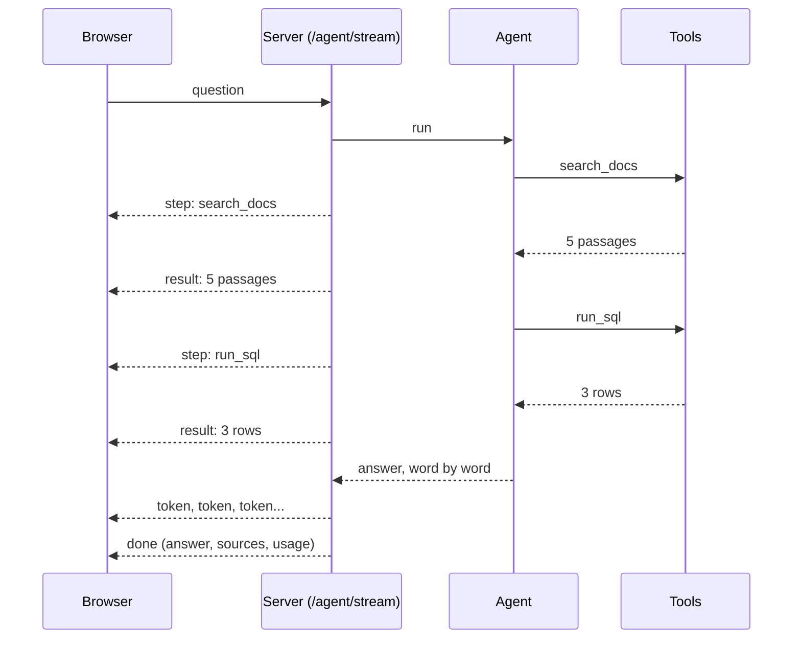

# Extra Slides: Streaming the Agent's Work

These slides are **new**. They are not in `WEBINAR_DECK_CONTENT.md` yet.
**Where they go:** in section I, right after slide 36 (architecture) and before slide 37 (demo script).
**Time:** about 4 minutes. To keep the 120-minute plan, take 2 minutes from slide 31 and 2 minutes from the Q&A buffer.
**Same style as the main file:** simple English, one real-life example, a diagram, a little code, speaker notes.
Tags: **[BUILT]** we built and tested it. **[VERIFY]** check again before presenting.

---

## Slide S1: The waiting problem [BUILT]
**On slide:** An agent can take 5 to 20 seconds to answer. A blank screen for that long feels broken.
- Our combined question (documents + database) took about 19 seconds in one test run.
- Streaming shows the work while it happens: first the tool calls, then the answer as it is written.
**Example:** A pizza tracker. You do not stare at a closed door for 30 minutes. You see "making", "baking", "on the way".
**Diagram:**

**Say:** The agent is not faster. It only feels faster, and the audience can see how it thinks.
**Image:** two phone screens: one with a spinner, one with a live checklist.

## Slide S2: How streaming works [BUILT]
**On slide:** The server sends small messages (events) while the agent works. The browser draws each one as it arrives.
- Five kinds of event: **start**, **step** (a tool is called), **result** (the tool finished), **token** (a piece of the answer), **done** (the full result).
- The technology is called server-sent events. It is one normal web request that stays open.
**Example:** A live sports commentary. The commentator talks during the match, not after it.
**Diagram:**

**Say:** Follow one arrow at a time. The browser never has to ask again: the server keeps talking.
**Image:** the diagram above.

## Slide S3: A real run, with times [BUILT]
**On slide:** This is a real timeline from our test (one run, free Gemini key).
| Time | Event |
|---|---|
| 2.2 s | step: search_docs |
| 3.0 s | result: 5 passages |
| 4.2 s | step: list_tables, result |
| 15.2 s | step: describe_table, result |
| 16.2 s | step: run_sql, result: 3 rows |
| 17.9 s | answer starts: 12 token pieces |
| 18.6 s | done |

**Example:** The question was "Which delivered orders were late, and what credit does the policy give per band?" The user sees the first action after about 2 seconds, not after 19.
**Say:** Notice the long gap before describe_table. That is the model thinking, and it varies from run to run. [VERIFY: the times differ every run, so say "about"]
**Image:** a timeline bar with the events as dots.

## Slide S4: Does streaming cost more? [BUILT]
**On slide:** No. It is the same work, delivered differently.
| | Without streaming | With streaming |
|---|---|---|
| Model calls | the same | the same |
| Tokens billed | the same | the same |
| Free-tier limit (15 requests per minute) | counts the same | counts the same |
| What the user feels | waits for everything | sees progress at once |
**Example:** A parcel is the same parcel whether or not you get tracking updates.
**Also true (be honest):**
- More moving parts: if the connection drops halfway, the user sees a partial answer. Our page shows a clear message.
- A little more work for the server, which could matter on a very small free plan. We did not measure it. [VERIFY]
- The answer words come at the end, because the model writes its final text after the tool calls. The tool steps are what streams early.
**Say:** The only way streaming could cost more is a bad design, such as asking the model twice. We do not do that.
**Image:** a "same price" tag on both sides.

## Slide S5: A little code [BUILT]
**On slide:** The server sends each event as one line of text. The browser reads the lines as they arrive.
**Code (server, simplified):**
```python
def generate():
    for event in agent.stream(question):          # step, result, token, done
        yield f"data: {json.dumps(event)}\n\n"    # one event = one message

return StreamingResponse(generate(), media_type="text/event-stream")
```
**Code (browser, simplified):**
```javascript
const reader = response.body.getReader();
while (true) {
  const { value, done } = await reader.read();   // wait for the next piece
  if (done) break;
  // split into events, then update the chat on screen
}
```
**Say:** That is all of it: a generator on one side, a reader on the other.
**Image:** two short code boxes with an arrow between them.

## Slide S6: How LangGraph helps [BUILT]
**On slide:** LangGraph can tell us two things while it runs:
- **updates:** a step has finished (the agent asked for a tool, or a tool returned).
- **messages:** the words the model is writing right now.
**Example:** A kitchen with two screens. One shows each dish as it is finished. The other shows the chef writing the menu card letter by letter.
**Code:**
```python
for mode, payload in graph.stream(inputs, config, stream_mode=["updates", "messages"]):
    ...  # updates -> step / result events,  messages -> token events
```
**Say:** Our hand-written loop can stream the steps too. Its final answer arrives in one piece. The LangGraph version streams the words as well.
**Image:** two screens: "steps finished" and "words being written".

---

## Demo notes for the presenter
1. Open the Chat page. Ask the combined late-delivery question. Keep the "tool calls" panel visible: it opens by itself while the agent works and shows "(running...)" on the current step.
2. Point out: step appears, then "→ 5 passages", then the SQL step with its row count, then the answer typing out.
3. After the answer, read the small line under it: how many model calls and prompt tokens were used (and how many came from the cache).
4. Say the slide S4 sentence: "Same tokens, same cost. Only the delivery changed."
5. Backup: if streaming fails on stage, the old endpoint `/agent` still works, and so does a screen recording.

## Before presenting
- [ ] Open the chat page in a real browser and try one question. We tested the server stream with live Gemini calls and checked that the page script parses, but **we have not watched the page itself in a browser yet**.
- [ ] Wake the Render service 5 minutes early. Check that the stream arrives step by step on Render, not all at once at the end. We tested only on the local computer. [VERIFY]
- [ ] Remember the free Gemini key allows about 15 requests per minute. One question uses 2 to 6.
